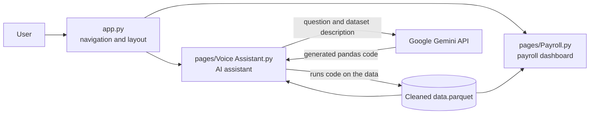
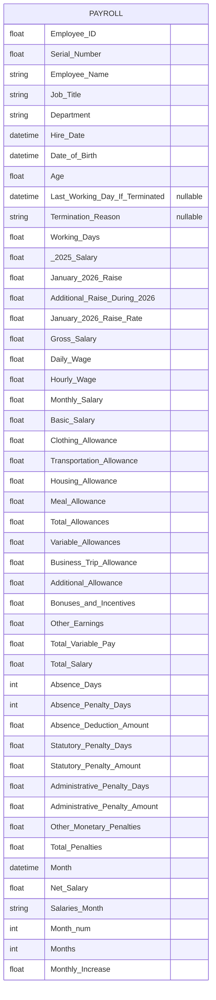
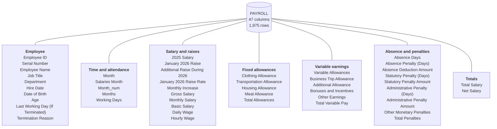
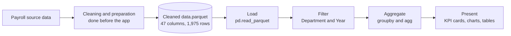
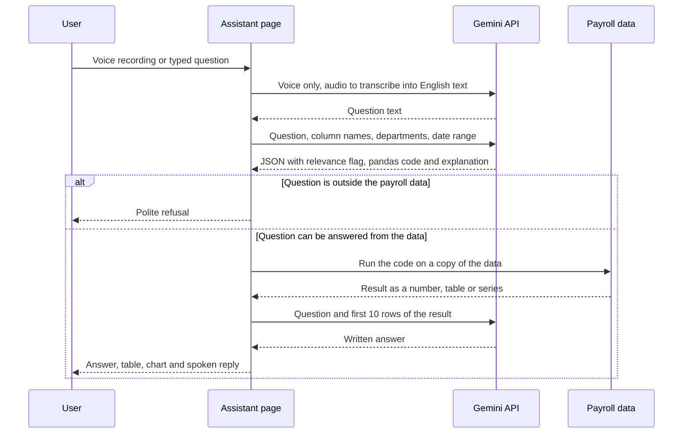

# HR Analytics Dashboard - Mid Project

An interactive web application that turns the company's payroll data into clear, filterable reports, and lets users ask questions about the data in plain English by voice or text.

The application is built with Streamlit, pandas and Plotly. Payroll reporting is complete. Recruitment, performance, and training and development reports are planned.

## Contents

1. [Features](#features)
2. [Architecture](#architecture)
3. [Project structure](#project-structure)
4. [Data and schema](#data-and-schema)
5. [Data pipeline](#data-pipeline)
6. [Getting started](#getting-started)
7. [Configuration](#configuration)
8. [Roadmap](#roadmap)

## Features

**Payroll dashboard**

Two filters, Department and Year, apply to every KPI and chart on the page. Four report tabs:

| Tab | What it shows |
|---|---|
| Overall summary | Department table, total salaries, employees, earnings and deductions, termination reasons, 2026 hires per month, raises per month |
| Onboarding details | Employees and leaves per department, hires, leaves and turnover ratios, turnover per job title |
| Earning details | Totals by earning type (bonus, allowances, other), monthly bonus against headcount, earnings per department, business trip employees |
| Deduction details | Total penalties, absence, administrative penalties and statutory penalties, each with KPI cards and a chart |

**AI assistant**

- Questions can be typed, chosen from suggestions, or recorded by voice.
- Google Gemini converts each question into pandas code, which runs on the payroll data. Answers are calculated, not estimated.
- Results are shown as a written answer, a table, an automatic chart where suitable, and a spoken reply.
- Questions unrelated to the payroll data are declined.

**Interface**

- Sidebar navigation grouped by HR area, with the company logo.
- Light and dark mode toggle.
- Colour palette taken from the company logo.

## Architecture



`app.py` defines the pages and the sidebar. Each page loads the same parquet file. The assistant sends Gemini the question together with the column names, department names and date range, runs the returned code locally, and then sends the calculated result (its first 10 rows) back to Gemini to phrase the answer.

## Project structure

```text
Final Project/
|-- IMG_1343.png                 Company logo
`-- Code/
    |-- app.py                   Entry point, page registration, navigation
    |-- theme.py                 Shared colours, CSS and chart styling
    |-- Cleaned data.parquet     Payroll dataset
    |-- .env                     Gemini API key (not committed)
    `-- pages/
        |-- Payroll.py           Payroll dashboard (four tabs)
        |-- Voice Assistant.py   AI payroll assistant
        |-- Recruitment Dashboard.py    Planned
        `-- Recruitment Reports.py      Planned
```

## Data and schema

The application reads one file, `Cleaned data.parquet`. It is a flat, denormalised table: each row is the monthly payroll record of one employee.

| Property | Value |
|---|---|
| Rows | 1,975 |
| Data columns | 47 |
| Unique employees | 254 |
| Departments | 12 |
| Period | January 2026 to September 2026 |
| Column types | 34 floating point, 6 integer (including 4 dates), 5 text, 2 integer month fields |

The schema below was read from the parquet file itself. To print it on your machine:

```bash
python -c "import pandas as pd; print(pd.read_parquet('Cleaned data.parquet').dtypes)"
```

### Table structure

Spaces and parentheses in column names are replaced with underscores in the diagram only, and `2025 Salary` is written `_2025_Salary` because diagram attribute names cannot start with a digit. The exact names are in the data dictionary below.



### Column groups



### Data dictionary

Types are the pandas types read from the file. Only two columns contain empty values: `Last Working Day (If Terminated)` and `Termination Reason` are empty for active employees (1,955 of 1,975 rows). Every other column is fully populated.

**Employee**

| Column | Type | Description |
|---|---|---|
| `Employee ID` | float64 | Employee identifier, 1001 to 1254. Stored as a decimal number. |
| `Serial Number` | float64 | Serial number, 1 to 237. |
| `Employee Name` | text | Employee name. |
| `Job Title` | text | Employee role. Used for turnover per job title. |
| `Department` | text | One of 12 departments. Used by the dashboard filter. |
| `Hire Date` | datetime | Date of hire, 2021-01-01 to 2026-09-30. Drives the Year filter and the 2026 hires chart. |
| `Date of Birth` | datetime | Date of birth. |
| `Age` | float64 | Age in years, 23 to 56. |
| `Last Working Day (If Terminated)` | datetime, empty for active staff | Last working day of a terminated employee. |
| `Termination Reason` | text, empty for active staff | Reason for leaving. Used for the termination reasons chart and leave counts. |

**Time and attendance**

| Column | Type | Description |
|---|---|---|
| `Month` | datetime | First day of the salary month, 2026-01-01 to 2026-09-01. |
| `Salaries Month` | text | Salary month name, used as the chart axis label. |
| `Month_num` | int32 | Month number, 1 to 9. Sorts months in calendar order. |
| `Months` | int32 | Month number, 1 to 12. Not used by the dashboard. |
| `Working Days` | float64 | Working days in the record, 1 to 30. |

**Salary and raises**

| Column | Type | Description |
|---|---|---|
| `2025 Salary` | float64 | Salary for 2025. |
| `January 2026 Raise` | float64 | Raise amount applied in January 2026. |
| `Additional Raise During 2026` | float64 | Further raise amount during 2026. |
| `January 2026 Raise Rate` | float64 | January 2026 raise as a rate, 0 to 0.28. |
| `Monthly Increase` | float64 | Raise amount for the month. Summed in the raises per month chart. |
| `Gross Salary` | float64 | Gross salary. Summed per department in the summary table. |
| `Monthly Salary` | float64 | Monthly salary. |
| `Basic Salary` | float64 | Basic salary component. |
| `Daily Wage` | float64 | Daily wage. |
| `Hourly Wage` | float64 | Hourly wage. |

**Fixed allowances**

| Column | Type | Description |
|---|---|---|
| `Clothing Allowance` | float64 | Clothing allowance. |
| `Transportation Allowance` | float64 | Transportation allowance. |
| `Housing Allowance` | float64 | Housing allowance. |
| `Meal Allowance` | float64 | Meal allowance. |
| `Total Allowances` | float64 | Total of the fixed allowances. |

**Variable earnings**

| Column | Type | Description |
|---|---|---|
| `Variable Allowances` | float64 | Variable allowance payments. |
| `Business Trip Allowance` | float64 | Business trip allowance. Rows above zero identify trip employees. |
| `Additional Allowance` | float64 | Additional allowance payments. |
| `Bonuses and Incentives` | float64 | Bonus and incentive payments. |
| `Other Earnings` | float64 | Other earnings. |
| `Total Variable Pay` | float64 | Total of variable earnings. Reported as total earnings. |

**Absence and penalties**

| Column | Type | Description |
|---|---|---|
| `Absence Days` | int64 | Days absent, 0 to 15. |
| `Absence Penalty (Days)` | int64 | Penalty days applied for absence, 0 to 10. |
| `Absence Deduction Amount` | float64 | Amount deducted for absence. |
| `Statutory Penalty (Days)` | float64 | Penalty days under statutory rules, 0 to 3. |
| `Statutory Penalty Amount` | float64 | Amount deducted for statutory penalties. |
| `Administrative Penalty (Days)` | float64 | Penalty days from administrative actions, 0 to 5. |
| `Administrative Penalty Amount` | float64 | Amount deducted for administrative penalties. |
| `Other Monetary Penalties` | float64 | Other monetary penalties. |
| `Total Penalties` | float64 | Total penalty value. Reported as total deductions. |

**Totals**

| Column | Type | Description |
|---|---|---|
| `Total Salary` | float64 | Total salary before deductions. |
| `Net Salary` | float64 | Salary after deductions. Reported as total salaries. |

The file also stores the pandas index as `__index_level_0__` (0 to 1974). It is not a data column.

### How reports use the columns

| Report measure | Columns | Calculation |
|---|---|---|
| Total salaries | `Net Salary` | Sum |
| Total employees | `Employee ID` | Distinct count |
| Total earnings | `Total Variable Pay` | Sum |
| Total deductions | `Total Penalties` | Sum |
| Department summary | `Department`, `Employee ID`, `Gross Salary` | Distinct employees and summed gross salary per department |
| Termination reasons | `Termination Reason` | Count by reason |
| New hires per month | `Hire Date`, `Employee ID` | Distinct employees hired in 2026, by month |
| Raises per month | `Monthly Increase`, `Salaries Month`, `Month_num` | Sum by month |
| Turnover per job title | `Job Title`, `Termination Reason`, `Employee ID` | Leaves divided by employees |
| Earnings by type | `Bonuses and Incentives`, `Additional Allowance`, `Other Earnings`, `Variable Allowances`, `Business Trip Allowance` | Sum of each |
| Absence | `Absence Days`, `Absence Deduction Amount`, `Absence Penalty (Days)` | Employees, amount and days by department |
| Administrative penalties | `Administrative Penalty (Days)` | Employees and days by department |
| Statutory penalties | `Statutory Penalty (Days)`, `Statutory Penalty Amount` | Employees, amount and days by department |

## Data pipeline

Data moves through the application in the stages below, from the cleaned file to the screen.



| Stage | Where | What happens |
|---|---|---|
| Source and cleaning | Outside the application | The payroll data is cleaned and saved as `Cleaned data.parquet`. The application does not clean or recalculate data. It expects the file to be ready, including the helper columns `Month`, `Salaries Month` and `Month_num`. |
| Load | `Payroll.py`, `Voice Assistant.py` | Each page reads the parquet file with pandas. The assistant caches the loaded data. |
| Filter | `Payroll.py` | The Department and Year selections (Year is the year of `Hire Date`) produce a filtered copy of the data. The report tabs read from this copy. |
| Aggregate | `Payroll.py` | Each KPI and chart is built with pandas `groupby` and `agg`, for example distinct employees per department or summed raises per month. |
| Present | `Payroll.py` | KPI cards (`st.metric`), Plotly charts and tables are drawn, using the shared colours and chart style. |

### AI assistant pipeline

The assistant adds a second path through the data. A question is turned into a calculation on the same parquet file.



- The application tries several Gemini models in turn. If one is unavailable or rate limited, it moves to the next.
- The generated code runs locally on a copy of the data, so the dataset itself is never modified.
- A bar chart is added automatically when the result is a table with at least one text column and one numeric column.
- The spoken reply is generated with gTTS and is shortened to the first 800 characters.

## Getting started

**Requirements**

- Python 3.10 or later
- A recent Streamlit release. The app uses `st.navigation`, `st.audio_input` and container keys.
- A Google Gemini API key, for the AI assistant only

**Install**

```bash
pip install streamlit pandas numpy plotly pyarrow requests python-dotenv gtts tabulate
```

**Run**

```bash
cd Code
streamlit run app.py
```

The application opens in the browser at `http://localhost:8501`.

## Configuration

**Gemini API key.** Create a `.env` file in the `Code` folder (or its parent) containing:

```text
GEMINI_API_KEY=your_key_here
```

The assistant also accepts the variable name `gemini_api`. If no key is found, the sidebar shows a password field to enter one for the session. Do not commit the `.env` file.

**File paths.** `app.py` and `Payroll.py` currently use absolute paths for the logo, the page files and the parquet file. When moving the project to another machine, update these paths, or replace them with paths relative to the `Code` folder. The assistant already searches several relative locations for the parquet file and the `.env` file.

## Roadmap

| Area | Status |
|---|---|
| Payroll dashboard and AI assistant | Complete |
| Recruitment dashboard and reports | Planned |
| Performance reports | Planned |
| Training and development reports | Planned |
| Further HR reports | Planned |

Each new area will be added as pages in the same sidebar, sharing the same filters, KPI cards and chart style.
